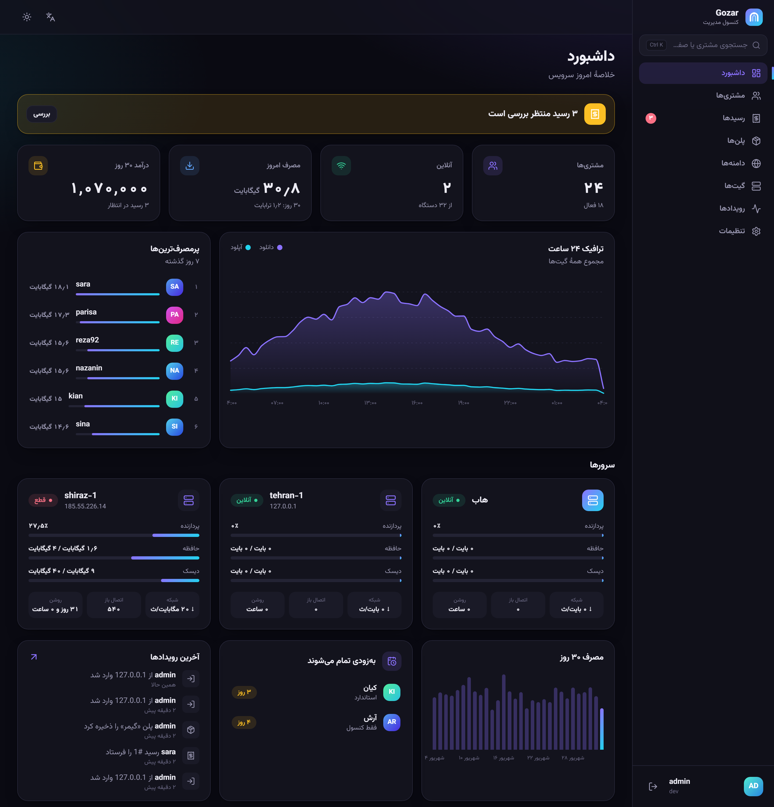
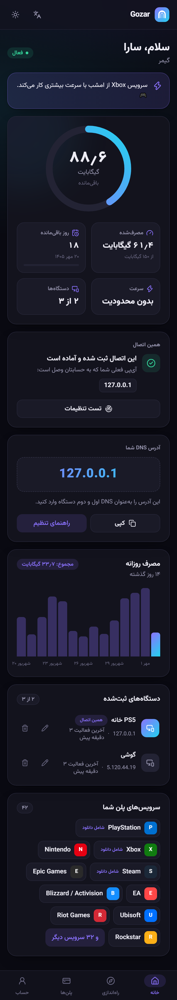
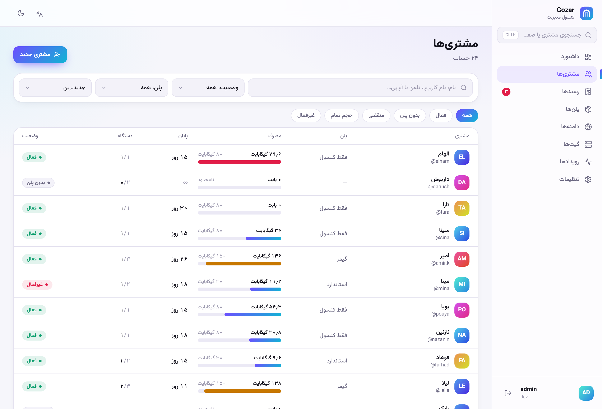
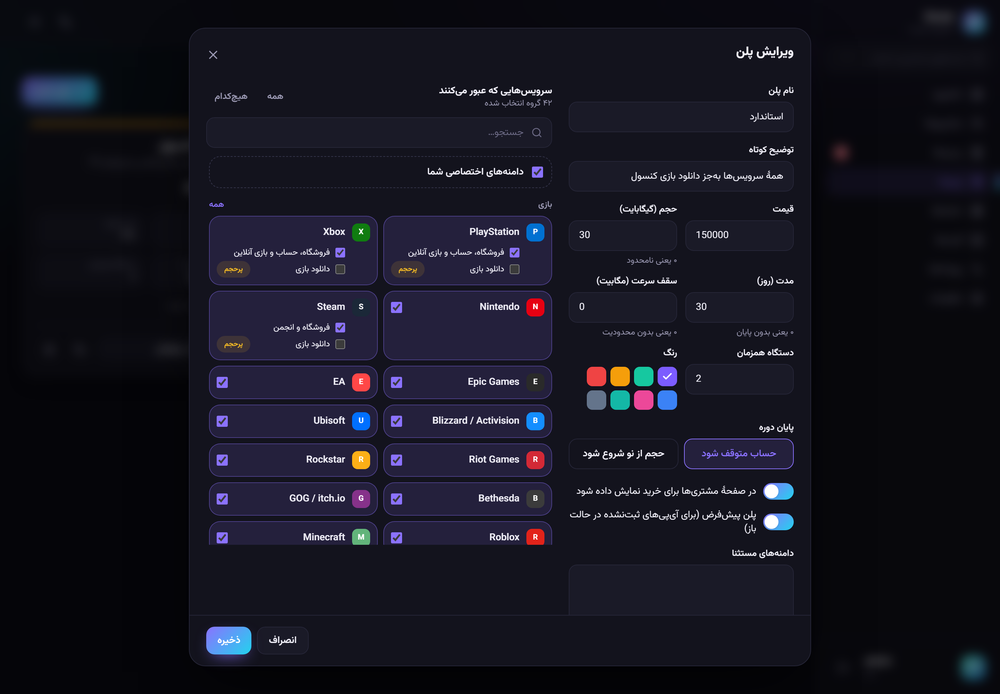
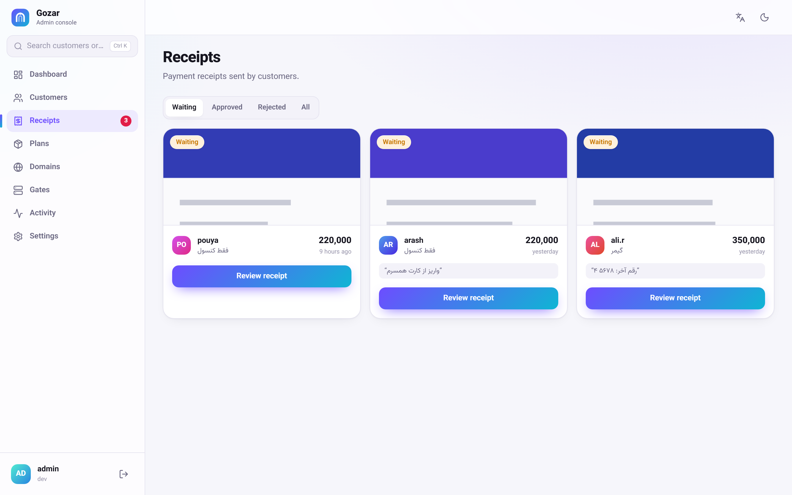
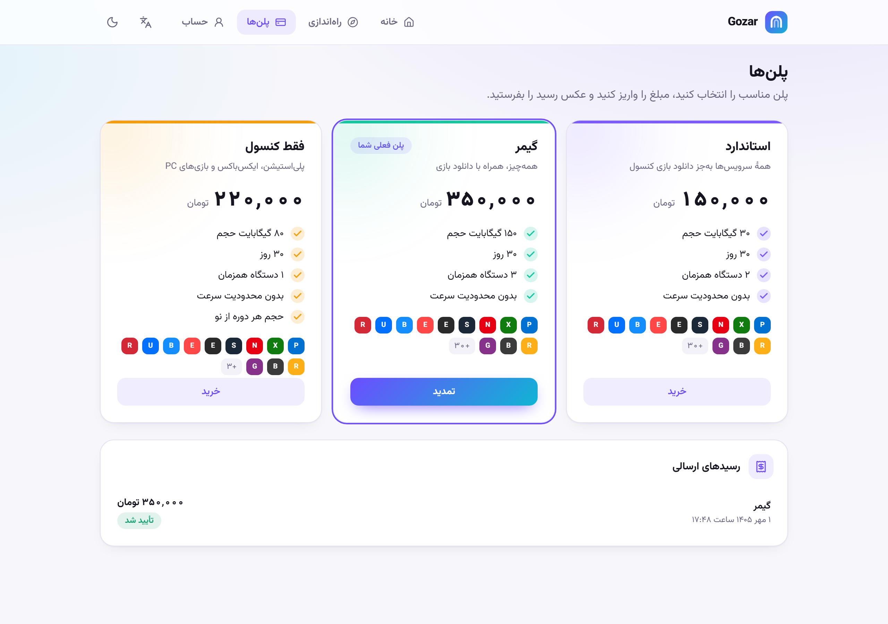
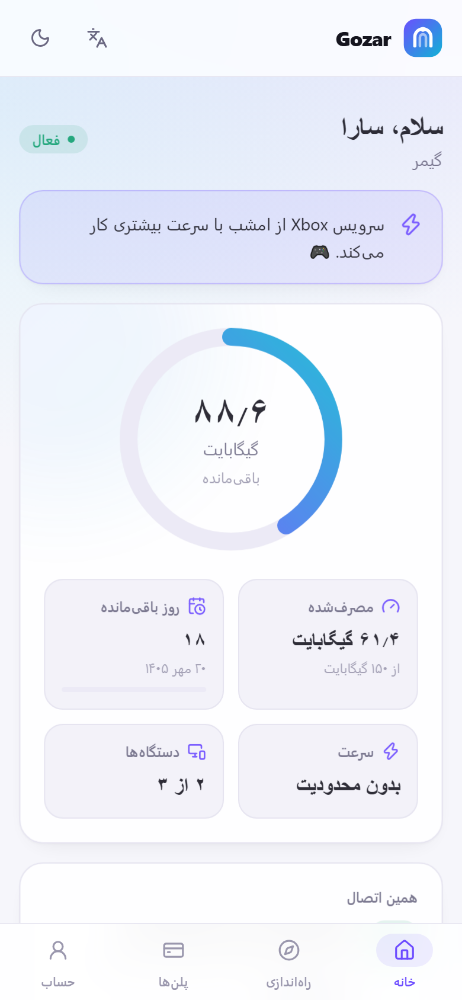
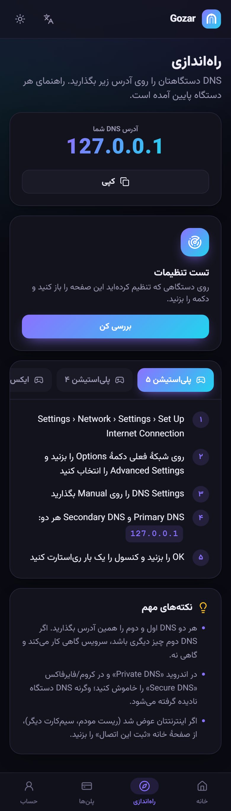

<div dir="rtl">

<div align="center">


# گذر (Gozar)

**دروازهٔ DNS هوشمند، با یک محصول کامل دورش.**
مشتری فقط DNS دستگاهش را عوض می‌کند؛ سرویس‌های تحریم‌شده باز می‌شوند و بقیهٔ اینترنت مثل قبل مستقیم می‌ماند.

*[English](README.md)*

</div>

<p align="center">
  
  
</p>

---

## چطور کار می‌کند

</div>

```
 دستگاه مشتری               گیت (داخل کشور)                          هاب (خارج)               سرویس
 ┌──────────────┐  DNS     ┌──────────────────────────┐              ┌──────────────────┐    ┌─────────┐
 │ PS5، گوشی،   │ ───────► │ DNS داخلی                │              │ خروجی            │    │ Sony    │
 │ لپ‌تاپ        │          │  دامنهٔ مسیریابی‌شده؟     │   TCP، TLS   │  نام را می‌خواند  │    │ Steam   │
 │              │  TLS     │  با آی‌پی گیت جواب بده    │   دست‌نخورده  │  و وصل می‌شود     │ ─► │ OpenAI  │
 │              │ ───────► │ پراکسی: SNI، بررسی پلن،  │ ───────────► │                  │    │ …       │
 └──────────────┘          │ شمارش مصرف، محدودیت سرعت │              │ دیتابیس، کنسول   │    └─────────┘
                           │ پنل مشتری                │ ◄── همگام ── │ مدیریت، API      │
                           └──────────────────────────┘   هر ۳۰ ثانیه └──────────────────┘
```

<div dir="rtl">

* **گیت** DNS مشتری‌ها را جواب می‌دهد. دامنه‌ای که پلن مشتری عبورش می‌دهد به آی‌پی خود گیت اشاره می‌کند؛ بقیه عادی resolve می‌شوند و اصلاً از گذر رد نمی‌شوند.
* اتصال به‌صورت TCP خام به **هاب** برده می‌شود. TLS هیچ‌وقت باز یا رمزگشایی نمی‌شود — گیت فقط نام میزبانی را که کلاینت اعلام می‌کند می‌خواند.
* هاب یک دیتابیس برای همهٔ گیت‌ها دارد؛ سهمیهٔ مشتری روی همهٔ گیت‌ها یکی است. همیشه گیت به هاب وصل می‌شود، نه برعکس.

همه‌چیز — سرور DNS، پراکسی، محدودیت سرعت، شمارش مصرف، STUN، گواهی‌ها و هر دو پنل وب — **یک فایل اجرایی Go** است. بدون nginx، بدون dnsmasq، بدون قوانین nftables، بدون داکر و بدون نصب pip یا npm روی سرور.

## امکانات

| | |
|---|---|
| **پنل مشتری** | ثبت‌نام، ثبت دستگاه با یک لمس، حلقهٔ مصرف و نمودار روزانه، ثبت اتصال فعلی با یک لمس یا آی‌پی شبکهٔ دیگر به‌صورت دستی (مثلاً کنسول خانه)، راهنمای تنظیم برای هر دستگاه (PS5، Xbox، سوییچ، اندروید، آیفون، ویندوز، مک، مودم)، تست زندهٔ «DNS من درست تنظیم شده؟» |
| **کنسول مدیریت** | داشبورد زنده، مشتری‌ها با جستجو و فیلتر و Ctrl+K، ویرایشگر پلن با انتخاب تصویری سرویس‌ها، بررسی رسیدها، سلامت گیت‌ها، رویدادها، پشتیبان‌گیری و بازگردانی |
| **پرداخت** | زرین‌پال، آیدی‌پی و پی‌پینگ — هرکدام جداگانه روشن یا خاموش، تأیید پرداخت از خود گیت داخل ایران و تمدید خودکار پلن همان لحظه — و/یا کارت‌به‌کارت با عکس رسید برای تأیید شما |
| **پلن‌ها** | قیمت، حجم، مدت، سقف سرعت، تعداد دستگاه و دقیقاً اینکه کدام سرویس‌ها عبور کنند — تا سطح تک‌دامنه |
| **حسابداری** | شمارش بایت هر مشتری داخل خود پراکسی، همگام‌سازی بدون شمارش تکراری، سابقهٔ روزانه، انقضا و شروع دورهٔ خودکار |
| **محدودیت سرعت** | صف‌بندی، نه دور ریختن بسته: دانلود محدودشده روان ولی آهسته‌تر پیش می‌رود |
| **امنیت** | رمزها با Argon2id، توکن‌های نشست هش‌شده، ورود دومرحله‌ای TOTP برای مدیرها، محدودیت تلاش ورود، گواهی هاب pin شده، بدون پراکسی باز |
| **زبان** | فارسی (راست‌به‌چپ، تاریخ شمسی، اعداد فارسی) و انگلیسی، پوستهٔ روشن و تیره، فونت‌ها روی خود سرور |
| **گواهی** | Let's Encrypt از طریق TLS-ALPN روی پورت ۴۴۳ — پورت ۸۰ هیچ‌وقت قرض گرفته نمی‌شود، پس دانلود کنسول‌ها برای تمدید گواهی قطع نمی‌شود |

## تصاویر

</div>

| | |
|---|---|
|  |  |
|  |  |

<p align="center">
  
  
</p>

<div dir="rtl">

## نصب

دو سرور لینوکسی لازم دارید (Debian/Ubuntu یا هر توزیع با systemd)، هرکدام با یک آی‌پی عمومی IPv4:

* **هاب** — بیرون از شبکهٔ فیلترشده
* **گیت** — داخل کشور؛ مشتری‌ها آی‌پی آن را به‌عنوان DNS می‌گذارند

**۱. روی هاب:**

</div>

```bash
curl -fsSL https://raw.githubusercontent.com/amor7/gozarDNS/main/install.sh | sudo bash
```

<div dir="rtl">

گزینهٔ **Hub** را انتخاب کنید. نصاب یک دامنهٔ اختیاری برای کنسول می‌پرسد و در پایان آدرس کنسول، رمز مدیر (فقط یک بار) و یک **توکن اتصال** برای اولین گیت نشان می‌دهد.

**۲. روی گیت:** همان دستور را اجرا کنید، **Gate** را انتخاب کنید و توکن را بدهید. نصاب اتصال به هاب را بررسی می‌کند، در صورت نیاز پورت ۵۳ را از `systemd-resolved` آزاد می‌کند و سرویس را بالا می‌آورد.

تمام. کنسول را باز کنید، دو پلن آماده را تنظیم کنید و آدرس پنل مشتری را برای مشتری‌ها بفرستید.

### پورت‌ها

| | گیت | هاب |
|---|---|---|
| **۵۳** udp+tcp | DNS مشتری‌ها | — |
| **۸۰، ۴۴۳** tcp | ترافیک عبوری، پنل مشتری (با دامنه) | خروجی، فقط برای گیت‌ها؛ کنسول (با دامنه) |
| **۸۴۴۳** tcp | پنل مشتری با آی‌پی | — |
| **۳۴۷۸** udp | STUN برای تشخیص NAT کنسول | — |
| **۷۴۴۳** tcp | — | API همگام‌سازی گیت‌ها |
| پورت تصادفی | — | کنسول مدیریت (هنگام نصب انتخاب می‌شود) |

به SSH دست زده نمی‌شود. گذر فایروال شما را مدیریت نمی‌کند — این پورت‌ها را در پنل سرویس‌دهنده باز کنید.

### گیت تازه باز شروع می‌کند

گیت تازه به همه با پلن پیش‌فرض جواب می‌دهد تا بتوانید پیش از داشتن مشتری تستش کنید. به‌محض ثبت اولین مشتری، فقط آی‌پی‌های ثبت‌شده را قبول می‌کند. این رفتار برای هر گیت در کنسول قابل تغییر است (*گیت‌ها ← دسترسی*).

## دستورهای روزمره

</div>

```bash
sudo gozar status              # این سرور الان چه می‌کند
sudo gozar logs -f             # دنبال کردن لاگ‌ها (-e فقط هشدار و خطا)
sudo gozar watch sara          # گیت: درخواست‌های DNS یک مشتری به‌صورت زنده
sudo gozar check gemini.google.com sara   # گیت: با این دامنه چه می‌شود
sudo gozar admin password      # هاب: رمز تازه برای مدیر
sudo gozar admin 2fa-off admin # هاب: گوشی گم شده
sudo gozar gate add shiraz-1   # هاب: توکن برای گیت دیگر
sudo gozar backup              # هاب: پشتیبان کامل دیتابیس
sudo gozar update              # آخرین نسخه، با بررسی checksum
```

<div dir="rtl">

`gozar watch` ابزار پیدا کردن نیاز یک اپ است: اپ را روی دستگاه باز کنید تا خطا بدهد و ببینید کدام دامنه‌ها `direct` رفتند، کدام `routed` شدند و کدام داخل کشور `filtered` هستند. دامنه‌های جاافتاده را در *دامنه‌ها ← دامنه‌های اختصاصی* اضافه کنید.

## انتخاب سرور

مسیر شبکه بین گیت و هاب از هر چیزی در کد مهم‌تر است. بعضی رنج‌های خارجی از داخل کشور کند یا قطع‌اند، مهم نیست چه چیزی رویشان اجرا شود. هر دو سرور را اول ساعتی اجاره کنید، از چند اتصال مختلف تست کنید (اینترنت خانگی و موبایل رفتار متفاوتی دارند) و بعد قرارداد بلندمدت ببندید.

## توسعه

</div>

```bash
make web                     # ساخت هر دو پنل وب داخل باینری
make build                   # ./bin/gozar
make test

go run ./tools/devstack      # هاب و گیت روی همین سیستم با دادهٔ نمایشی
npm --prefix web run dev:admin    # http://localhost:5173  admin / admin12345
npm --prefix web run dev:portal   # http://localhost:5174  sara / sara1234
```

<div dir="rtl">

## محدودیت‌های شناخته‌شده

* فقط دانلود محدود می‌شود، آپلود نه.
* ترافیک دو بار حمل می‌شود (گیت و هاب): ۱ گیگابایت مصرف مشتری حدود ۲ گیگابایت روی هر سرور است.
* سرویس‌هایی که از HTTP(S) استفاده نمی‌کنند یا بدون DNS سیستم نام‌ها را پیدا می‌کنند، با DNS قابل مسیریابی نیستند.

## مجوز

MIT

</div>
